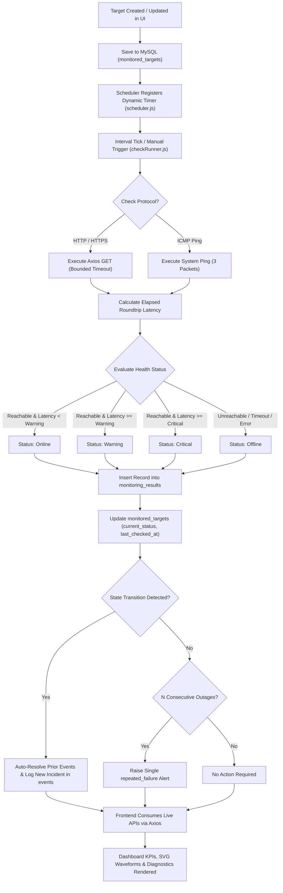
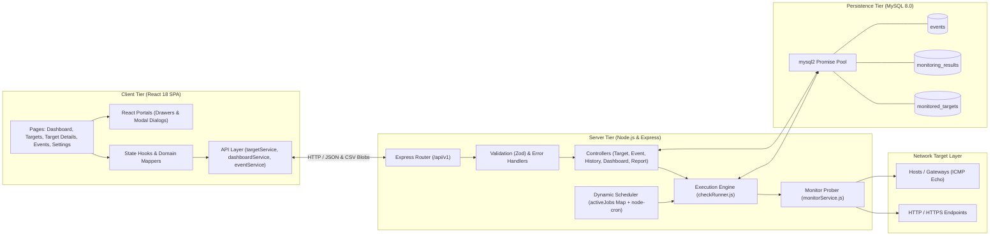
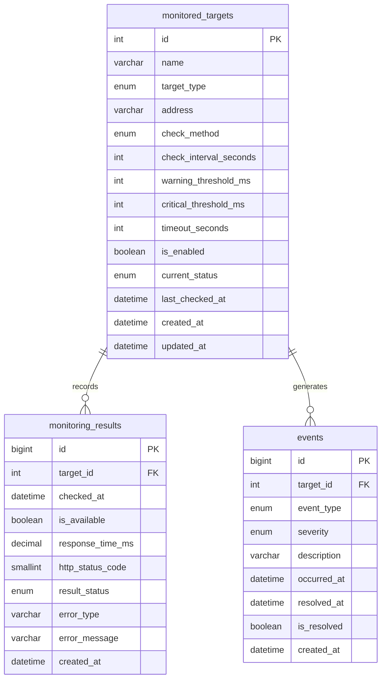

# NetPulse — Network Quality Monitoring System

[](https://nodejs.org/)
[](https://expressjs.com/)
[](https://react.dev/)
[](https://vitejs.dev/)
[](https://tailwindcss.com/)
[](https://www.mysql.com/)
[](https://github.com/saaddev2004/NetworkQualityMonitor)
[](https://github.com/saaddev2004/NetworkQualityMonitor)

NetPulse is an enterprise-grade network quality monitoring and availability auditing system engineered with Node.js, Express, React, and MySQL. It delivers automated probe scheduling across HTTP, HTTPS, and ICMP endpoints, real-time roundtrip response latency tracking, dual-tier SLA threshold breach classification, automated state-transition incident lifecycle management, and CSV diagnostic reporting.

Repository: [https://github.com/saaddev2004/NetworkQualityMonitor](https://github.com/saaddev2004/NetworkQualityMonitor)

---

## Table of Contents

- [Project Overview](#project-overview)
- [Key Features](#key-features)
- [How NetPulse Works](#how-netpulse-works)
- [System Architecture](#system-architecture)
- [Technology Stack](#technology-stack)
- [Installation and Setup](#installation-and-setup)
- [Environment Variables](#environment-variables)
- [API Documentation](#api-documentation)
- [Database Structure](#database-structure)
- [Monitoring Methodology and Logic](#monitoring-methodology-and-logic)
- [Dashboard and Monitoring Analytics](#dashboard-and-monitoring-analytics)
- [Testing and Verification](#testing-and-verification)
- [Project Structure](#project-structure)
- [Future Improvements](#future-improvements)
- [Author](#author)
- [License](#license)

---

## Project Overview

Modern digital services rely on consistent availability, low roundtrip latency, and reliable packet routing across distributed infrastructures. When endpoints degrade or fail, organizations suffer silent revenue losses and broken user experiences before traditional manual checks uncover the outage.

**NetPulse** solves this operational bottleneck by providing an automated, lightweight, self-hosted network quality monitoring platform. It actively monitors websites, APIs, microservices, and network hosts at user-defined intervals (e.g., 30s, 60s, 300s). NetPulse measures microsecond-accurate roundtrip latencies, detects connection timeouts or protocol errors, tracks rolling 24-hour fleet availability percentages, logs granular SLA incidents, and visualizes chronological latency waveforms.

### Intended Users and Use Cases
- **DevOps and Site Reliability Engineers (SREs):** Continuously audit external service availability, DNS resolution, and latency degradation across production clusters.
- **System Administrators:** Monitor internal host reachability through ICMP ping, detect intermittent packet drops, and isolate failing gateways.
- **Software Engineers:** Benchmark API endpoint response latencies against strict warning and critical SLA thresholds before deploying updates.
- **Academic and Enterprise Evaluators:** Analyze an end-to-end telemetry system combining reactive UI patterns, transactional relational database models, and background execution schedulers.

---

## Key Features

- **Automated Multi-Protocol Probing:** Scheduled background checks over ICMP Ping, HTTP, and HTTPS protocols without third-party external probe services.
- **High-Precision Latency Measurement:** Millisecond-accurate roundtrip latency logging for every probe cycle, strictly recording `NULL` (never fabricated zeros) on failed attempts.
- **Dynamic Scheduler Lifecycle:** Independent, configurable polling intervals per target (e.g., 10s to 3600s). Modifying, enabling, disabling, or deleting targets dynamically updates background timers in runtime memory.
- **Two-Tier SLA Threshold Evaluation:** User-configured `warning_threshold_ms` and `critical_threshold_ms` boundaries that automatically classify response health into `online`, `warning`, `critical`, or `offline` states.
- **Automated Incident Lifecycle & Deduplication:** State-transition event logging. Incidents open when targets enter degraded or offline states, automatically resolve when targets recover, and generate deduplicated `repeated_failure` alerts after consecutive failed checks.
- **Rolling Uptime & SLA Compliance:** Mathematical fleet and target uptime tracking:
  $$\text{Uptime \%} = \left( \frac{\text{Successful Probes}}{\text{Total Eligible Probes}} \right) \times 100$$
- **Chronological Response Time Charts:** SVG-rendered latency curves featuring warning/critical threshold lines, dynamic Y-axis scaling, and multi-range filters (`1h`, `6h`, `12h`, `24h`, `7d`).
- **Target Inventory Management:** Full provisioning workflow to create, edit, toggle enable/disable, run on-demand manual probes, and permanently delete targets.
- **Streaming RFC-4180 CSV Reports:** Streamed CSV downloads for configured targets and historical probe records, secured with formula injection neutralization.
- **Monitoring Engine Telemetry:** Real-time scheduler introspection exposing active in-flight checks, timer count, system uptime, and MySQL connection health.
- **Zero Mock Data in Production:** All dashboard KPIs, sparklines, tables, and charts strictly consume live MySQL database queries and REST API responses.

---

## How NetPulse Works

1. **Target Provisioning:** An operator configures an endpoint in the frontend with target name, address (URL or IP/hostname), protocol (`http` or `icmp`), polling interval, request timeout, and warning/critical threshold limits.
2. **Database Persistence:** The configuration is validated via Zod schemas and inserted into the MySQL `monitored_targets` table with UTC timestamps.
3. **Dynamic Timer Scheduling:** The background scheduler initializes an active `setInterval` timer mapped directly to the target ID and executes an immediate baseline probe.
4. **Probe Execution:** When the interval timer fires, the monitor engine routes execution to either:
   - `checkHttpTarget`: Sends an HTTP/HTTPS GET request with bounded timeout, max redirect limits, and status code evaluation.
   - `checkIcmpTarget`: Sends a 3-packet ICMP ping to determine packet transmission time and packet receipt.
5. **Metric Calculation & Concurrency Guard:** The elapsed roundtrip time is captured. If a probe for the same target is already in progress, the engine prevents overlapping executions.
6. **Result Logging:** The outcome (`is_available`, `response_time_ms`, `http_status_code`, error metadata) is saved as an immutable record in `monitoring_results`.
7. **Threshold & Status Assignment:** The result is evaluated against the target's threshold parameters to determine its current status (`online`, `warning`, `critical`, or `offline`).
8. **Incident Lifecycle Handling:** If the target transitioned from a previous state, earlier incidents are closed, and a new incident is created in `events`. If consecutive failures meet the outage threshold, a `repeated_failure` incident is raised.
9. **Automated Data Retention:** A daily midnight cron task cleans up monitoring records older than the configured retention period (default 30 days) to prevent unbounded table growth.
10. **Dashboard & UI Synchronization:** The React frontend polls and receives real-time metrics, updating KPI counters, availability status badges, and interactive SVG latency charts.



---

## System Architecture

NetPulse is built with a decoupled client-server architecture:

- **Frontend (Client Tier):** Single-page application built with React 18, React Router v7, and Tailwind CSS. Employs modular presentation components, dedicated Axios API client abstraction, native SVG visualization (no heavyweight third-party charting bloat), and React Portal drawers to guarantee 100% viewport containment.
- **Backend (Application Tier):** Express.js server running Node.js. Serves strict REST endpoints, encapsulates business logic inside dedicated services (`checkRunner`, `monitorService`, `eventService`), and maintains an active in-memory scheduler using `Map`-based timers and `node-cron`.
- **Database (Persistence Tier):** MySQL 8.0 relational database operating behind a managed connection pool (`mysql2/promise`). Enforces foreign key constraints with cascade deletion, UTC timestamp consistency, and composite indexing (`idx_history`, `idx_events_target_time`).



---

## Technology Stack

### Frontend
- **Framework:** React 18 (`react`, `react-dom`)
- **Build Tool:** Vite 6
- **Routing:** React Router v7 (`react-router-dom`)
- **HTTP Client:** Axios
- **Icons:** Lucide React (`lucide-react`)
- **Styling:** Tailwind CSS, PostCSS, Autoprefixer, Custom Telemetry Design Tokens

### Backend
- **Runtime Environment:** Node.js (v18.x or v20.x recommended)
- **Web Framework:** Express.js 4.x
- **Schema Validation:** Zod 3.x
- **Scheduler:** Dynamic Node `setInterval` timers & `node-cron`
- **Network Probing:** `axios` (HTTP/HTTPS bounded probing) & `ping` (Native ICMP Echo wrapper)
- **CORS Management:** `cors`
- **Environment Management:** `dotenv`

### Database
- **Engine:** MySQL 8.0+
- **Driver / Connector:** `mysql2/promise` (Connection pool with UTC timezone handling and numeric decimal parsing)

### Development & Testing
- **Test Framework:** Node.js Native Test Runner (`node --test`)
- **Assertions:** Node.js Native Strict Assertions (`node:assert/strict`)
- **Hot-Reloading:** Nodemon
- **Version Control:** Git & GitHub

---

## Installation and Setup

Follow these exact steps to run NetPulse locally.

### 1. Prerequisites
Ensure the following tools are installed on your machine:
- **Node.js:** v18.0.0 or higher ([Download Node.js](https://nodejs.org/))
- **npm:** v9.0.0 or higher
- **MySQL Server:** v8.0 or higher (running locally or accessible remotely)
- **Git:** Installed and available on your system path

### 2. Clone the Repository
```bash
git clone https://github.com/saaddev2004/NetworkQualityMonitor.git
cd NetworkQualityMonitor
```

### 3. Database Setup
Log in to your MySQL terminal or GUI client (e.g., MySQL Workbench, phpMyAdmin):
```bash
mysql -u root -p
```
Execute the database initialization script included in `backend/schema.sql`:
```sql
CREATE DATABASE IF NOT EXISTS network_monitor_db;
USE network_monitor_db;
```
Run the full schema commands from [`backend/schema.sql`](file:///d:/projects/Networking%20Monitoring/network-quality-monitor/backend/schema.sql) to create `monitored_targets`, `monitoring_results`, and `events` tables with all necessary foreign keys and indexes.

### 4. Configure Backend Environment
Navigate to the `backend/` directory and configure the `.env` file:
```bash
cd backend
```
Create or edit `.env` in `backend/` (or repository root):
```env
PORT=5000
DB_HOST=localhost
DB_USER=root
DB_PASSWORD=your_mysql_password
DB_NAME=network_monitor_db
RESULT_RETENTION_DAYS=30
REPEATED_FAILURE_THRESHOLD=3
NODE_ENV=development
```

### 5. Install Dependencies

**Install Backend Dependencies:**
```bash
# Inside backend/ directory:
npm install
```

**Install Frontend Dependencies:**
```bash
# In a new terminal, navigate to frontend/ directory:
cd ../frontend
npm install
```

### 6. Start the Application

**Terminal 1 — Start the Backend Server:**
```bash
cd backend
npm run dev
```
*The backend API will start on `http://localhost:5000` and automatically initialize the monitoring scheduler.*

**Terminal 2 — Start the Frontend Application:**
```bash
cd frontend
npm run dev
```
*Vite will compile and launch the frontend development server, typically on `http://localhost:5173` or `http://localhost:5174`.*

### 7. Access the Application
Open your browser and navigate to:
```
http://localhost:5173
```
*(or the local port indicated by your Vite terminal output).*

---

## Environment Variables

All backend configuration variables are loaded via `dotenv` in [`backend/src/config/env.js`](file:///d:/projects/Networking%20Monitoring/network-quality-monitor/backend/src/config/env.js):

| Variable | Description | Required | Default Value | Example Value |
| :--- | :--- | :---: | :--- | :--- |
| `PORT` | Port on which the Express REST API server listens | No | `5000` | `5000` |
| `DB_HOST` | Hostname or IP address of the MySQL database server | Yes | `localhost` | `127.0.0.1` |
| `DB_USER` | MySQL username with read/write privileges | Yes | `root` | `app_user` |
| `DB_PASSWORD` | MySQL user password | Yes | *(empty)* | `SuperSecurePassword123!` |
| `DB_NAME` | Name of the database schema | Yes | `network_monitor_db` | `network_monitor_db` |
| `RESULT_RETENTION_DAYS` | Number of days to retain records in `monitoring_results` | No | `30` | `14` |
| `REPEATED_FAILURE_THRESHOLD`| Consecutive failed checks needed to raise a `repeated_failure` alert | No | `3` | `5` |
| `NODE_ENV` | Application runtime environment mode | No | `development` | `production` |

---

## API Documentation

All endpoints are versioned under the `/api/v1` namespace.

### Health & Telemetry

#### `GET /api/v1/health`
Returns live system health, database connection state, and monitoring engine telemetry.
- **Request:** `GET http://localhost:5000/api/v1/health`
- **Response `200 OK`:**
```json
{
  "status": "ok",
  "message": "Application and Database are healthy",
  "timestamp": "2026-11-12T00:00:00.000Z",
  "database": {
    "status": "connected",
    "name": "network_monitor_db"
  },
  "engine": {
    "status": "running",
    "isRunning": true,
    "activeJobsCount": 4,
    "scheduledTargetIds": [1, 2, 3, 4],
    "retentionJob": "active",
    "retentionDays": 30,
    "uptimeSeconds": 1420
  },
  "system": {
    "nodeVersion": "v20.18.0",
    "platform": "win32",
    "environment": "development"
  }
}
```

---

### Dashboard

#### `GET /api/v1/dashboard/summary`
Calculates aggregated fleet health metrics, active incident counts, and rolling 24-hour fleet uptime.
- **Request:** `GET http://localhost:5000/api/v1/dashboard/summary`
- **Response `200 OK`:**
```json
{
  "totalTargets": 4,
  "onlineTargets": 2,
  "offlineTargets": 0,
  "warningTargets": 1,
  "criticalTargets": 1,
  "disabledTargets": 0,
  "unknownTargets": 0,
  "overallUptime": "98.1%",
  "overallUptimePercent": 98.1,
  "activeEvents": 2
}
```

---

### Targets Management

#### `POST /api/v1/targets`
Creates and registers a new monitored endpoint, automatically scheduling its background probe timer.
- **Request Body (JSON):**
```json
{
  "name": "Google DNS Gateway",
  "targetType": "host",
  "address": "8.8.8.8",
  "checkMethod": "icmp",
  "checkIntervalSeconds": 60,
  "warningThresholdMs": 100,
  "criticalThresholdMs": 300,
  "timeoutSeconds": 3
}
```
- **Response `201 Created`:**
```json
{
  "id": 5,
  "name": "Google DNS Gateway",
  "currentStatus": "unknown",
  "message": "Target created successfully"
}
```

#### `GET /api/v1/targets`
Retrieves all monitored endpoints. Supports optional filtering by status query parameter.
- **Query Parameters:** `?status=online|warning|critical|offline` (optional)
- **Response `200 OK`:**
```json
[
  {
    "id": 1,
    "name": "Cloudflare DNS",
    "target_type": "host",
    "address": "1.1.1.1",
    "check_method": "icmp",
    "check_interval_seconds": 60,
    "warning_threshold_ms": 100,
    "critical_threshold_ms": 300,
    "timeout_seconds": 2,
    "is_enabled": 1,
    "current_status": "online",
    "last_checked_at": "2026-11-12T00:05:00.000Z",
    "created_at": "2026-10-30T10:00:00.000Z",
    "updated_at": "2026-11-10T15:20:00.000Z"
  }
]
```

#### `GET /api/v1/targets/:id`
Retrieves full details for a single monitored target by its numeric ID.
- **Response `200 OK`:** Target object.
- **Response `404 Not Found`:** `{"error": {"code": "NOT_FOUND", "message": "Target not found"}}`

#### `PATCH /api/v1/targets/:id`
Partially updates an existing target configuration and reschedules its background timer in runtime memory.
- **Request Body (JSON):**
```json
{
  "warningThresholdMs": 150,
  "criticalThresholdMs": 400
}
```
- **Response `200 OK`:** `{"message": "Target updated successfully"}`

#### `DELETE /api/v1/targets/:id`
Permanently deletes a target, stops its background scheduler timer, and cascades deletion of its probe history and events.
- **Response `204 No Content`**

#### `PATCH /api/v1/targets/:id/enabled`
Enables or disables target monitoring. Disabling unschedules probe jobs and auto-resolves any open incidents.
- **Request Body (JSON):** `{"isEnabled": false}`
- **Response `200 OK`:** `{"message": "Target disabled successfully", "currentStatus": "disabled"}`

#### `POST /api/v1/targets/:id/check`
Executes an immediate manual probe cycle outside the scheduled interval.
- **Response `200 OK`:**
```json
{
  "message": "Manual check executed successfully",
  "target": "Cloudflare DNS",
  "method": "icmp",
  "status": "online",
  "previousStatus": "online",
  "result": {
    "isAvailable": true,
    "responseTimeMs": 14.5,
    "httpStatusCode": null,
    "errorType": null,
    "errorMessage": null
  }
}
```
- **Response `409 Conflict`:** If check is already running (`CHECK_IN_PROGRESS`) or target is disabled (`TARGET_DISABLED`).

---

### History & Uptime

#### `GET /api/v1/targets/:id/history`
Returns historical monitoring probe records for a target.
- **Query Parameters:**
  - `page` (integer, default: `1`)
  - `limit` (integer, min: `1`, max: `200`, default: `50`)
  - `from` (ISO 8601 string, optional)
  - `to` (ISO 8601 string, optional)
- **Response `200 OK`:** Array of probe results sorted descending by `checked_at`.

#### `GET /api/v1/targets/:id/uptime`
Calculates uptime SLA metrics for a specific target based on completed probes.
- **Response `200 OK`:**
```json
{
  "uptimePercentage": "99.85%",
  "uptimePercent": 99.85,
  "successfulChecks": 1340,
  "totalEligibleChecks": 1342
}
```

---

### Events & Incident Diagnostics

#### `GET /api/v1/events`
Returns system incident events joined with target metadata.
- **Query Parameters:**
  - `targetId` (integer, optional)
  - `isResolved` (`true` | `false`, optional)
  - `page` (integer, default: `1`)
  - `limit` (integer, default: `100`)
- **Response `200 OK`:**
```json
[
  {
    "id": 12,
    "target_id": 2,
    "target_name": "Production API Gateway",
    "target_address": "https://api.example.com/health",
    "event_type": "critical",
    "severity": "critical",
    "description": "Response time 840 ms exceeded critical threshold 500 ms",
    "occurred_at": "2026-11-12T00:10:00.000Z",
    "resolved_at": null,
    "is_resolved": 0,
    "created_at": "2026-11-12T00:10:00.000Z"
  }
]
```

---

### CSV Reports

#### `GET /api/v1/targets/reports/targets.csv`
Streams an RFC-4180 CSV export of all configured targets.

#### `GET /api/v1/targets/reports/results.csv`
Streams an RFC-4180 CSV export of historical probe results.
- **Query Parameters:** `?targetId=&from=&to=` (optional)

---

## Database Structure

NetPulse uses a relational MySQL database design with 3 core tables:



### Table Details

1. **`monitored_targets`**
   - Stores user-defined monitoring configurations, thresholds, and live statuses.
   - **Primary Key:** `id` (`INT UNSIGNED AUTO_INCREMENT`)
   - **Fields:** `name`, `target_type` (`website`, `http_service`, `host`), `address`, `check_method` (`http`, `icmp`), `check_interval_seconds`, `warning_threshold_ms`, `critical_threshold_ms`, `timeout_seconds`, `is_enabled`, `current_status`, `last_checked_at`, `created_at`, `updated_at`.

2. **`monitoring_results`**
   - High-throughput append-only log of every executed probe cycle.
   - **Primary Key:** `id` (`BIGINT UNSIGNED AUTO_INCREMENT`)
   - **Foreign Key:** `target_id` references `monitored_targets(id)` with `ON DELETE CASCADE`.
   - **Indexes:** `idx_history (target_id, checked_at)` and `idx_checked_at (checked_at)`.
   - **Fields:** `target_id`, `checked_at`, `is_available`, `response_time_ms`, `http_status_code`, `result_status`, `error_type`, `error_message`, `created_at`.

3. **`events`**
   - Audit trail of operational state transitions, SLA threshold violations, and incident recoveries.
   - **Primary Key:** `id` (`BIGINT UNSIGNED AUTO_INCREMENT`)
   - **Foreign Key:** `target_id` references `monitored_targets(id)` with `ON DELETE CASCADE`.
   - **Indexes:** `idx_events_target_time (target_id, occurred_at)` and `idx_is_resolved (is_resolved)`.
   - **Fields:** `target_id`, `event_type` (`warning`, `critical`, `offline`, `recovery`, `repeated_failure`), `severity` (`info`, `warning`, `critical`), `description`, `occurred_at`, `resolved_at`, `is_resolved`, `created_at`.

---

## Monitoring Methodology and Logic

### 1. ICMP Ping Monitoring
- **Mechanism:** Implemented via Node's `ping.promise.probe(address, { timeout, min_reply: 3 })`.
- **Packet Transmission:** Dispatches 3 ICMP Echo Request packets per check to compute a robust average roundtrip latency, adapting OS flags (`-n` on Windows, `-c` on POSIX systems).
- **Latency Measurement:** When replies are received (`alive: true`), the average packet latency is converted to a numeric millisecond value.
- **Failure Classification:** If no echo replies are received, `is_available` is set to `false`, `responseTimeMs` is set to `NULL`, and `errorType` is classified as `PING_FAILED`.

### 2. HTTP & HTTPS Monitoring
- **Mechanism:** Implemented using Axios (`axios.get`) with strict execution constraints:
  - Configurable request timeout: `timeoutSeconds * 1000`.
  - Bounded redirect policy: `maxRedirects: 3` (prevents redirect loop exhaustion).
  - Controlled status code validation: `validateStatus: false` so 4xx/5xx responses can be parsed gracefully.
- **Latency Measurement:** Captured via high-resolution timestamps:
  $$\text{Latency} = t_{\text{response received}} - t_{\text{request dispatched}}$$
- **Evaluation Criteria:**
  - **Successful Probe:** HTTP status codes in the range `200 <= status < 400` are marked as `is_available = true`.
  - **Application Error:** HTTP status codes `>= 400` are marked as `is_available = false`, with `errorType: 'HTTP_ERROR'`.
  - **Network Failure:** DNS resolution failures, connection resets, or timeouts throw network errors, recorded with `responseTimeMs: NULL` and categorized by their Node error code (e.g., `ENOTFOUND`, `ECONNREFUSED`, `ETIMEDOUT`).

### 3. Threshold Evaluation Logic
Every completed check is mapped to a status through [`evaluateStatus`](file:///d:/projects/Networking%20Monitoring/network-quality-monitor/backend/src/services/checkRunner.js#L13):
```javascript
if (!result.isAvailable) return 'offline';
if (result.responseTimeMs >= target.critical_threshold_ms) return 'critical';
if (result.responseTimeMs >= target.warning_threshold_ms) return 'warning';
return 'online';
```

### 4. Incident Transitions & Alert Deduplication
- **State Changes:** Events are raised **only when status changes** between check cycles.
- **Superseding & Resolution:** If a target transitions from `warning` to `critical`, the earlier `warning` incident is resolved and a new `critical` incident opens. When the target latency returns below thresholds, previous incidents are marked `is_resolved = true` with a timestamp, and an informational `recovery` event is appended.
- **Consecutive Outages:** When an outage persists, NetPulse tracks consecutive failures. Upon reaching the configured `REPEATED_FAILURE_THRESHOLD` (default: 3), a single `repeated_failure` alert is raised—preventing alert fatigue and inbox flooding.

---

## Dashboard and Monitoring Analytics

The NetPulse Dashboard aggregates operational metrics directly from backend APIs:

- **Executive KPI Cards:**
  - **Fleet Health Ratio:** Visual proportion of online targets to total targets.
  - **Degraded Status Counters:** Isolated counts for Warning, Critical, Offline, and Disabled endpoints.
  - **Active Incidents Pill:** Real-time badge tracking unresolved alerts.
  - **Rolling 24h Fleet Uptime:** Mathematically weighted uptime percentage across all probe cycles within the last 24 hours.
- **Target Response Time Waveforms:**
  - Interactive SVG time-series charts displaying chronological latency curves.
  - Color-coded SLA threshold lines: Amber dashed line for Warning threshold, Red dashed line for Critical threshold.
  - Timeframe toggles (`1h`, `6h`, `12h`, `24h`, `7d`).
- **Target Details Diagnostics:**
  - 30-day availability blocks and historical compliance percentage.
  - Granular probe logs table with timestamp, HTTP/Ping status, latency, and error diagnoses.
  - Inline SLA threshold editing card with immediate validation and persistence.
- **Diagnostic Incidents Table:**
  - Filterable by severity (`all`, `warning`, `critical`, `info`) and resolution state (`active`, `resolved`).
  - Slide-out diagnostics drawer with timeline tracking occurrence duration and automated recovery timestamps.

---

## Testing and Verification

NetPulse includes an automated testing suite utilizing Node.js's native test runner (`node --test`) and strict assertion module (`node:assert/strict`).

### Run Backend Automated Tests
```bash
npm --prefix backend test
```

### Test Suite Execution Output
```
> backend@1.0.0 test
> node --test

✔ POST /targets with bad input -> 422 VALIDATION_ERROR
✔ PATCH /targets/:id with empty body -> 422
✔ PATCH /targets/:id/enabled needs a real boolean
✔ history/uptime/events/export reject bad query params -> 422
✔ malformed JSON -> 400 INVALID_JSON
✔ unknown API route -> JSON 404
✔ health returns 503 (not a crash) when the DB is unreachable
✔ health returns 200 with engine telemetry and database status
✔ GET /targets with invalid status -> 400 INVALID_STATUS
✔ GET /targets without status parameter returns all targets
✔ GET /targets?status=online returns only online targets
✔ GET /targets?status=warning returns only warning targets
✔ GET /targets?status=critical returns only critical targets
✔ GET /targets?status=offline returns only offline targets
✔ POST /targets/:id/check on non-existent target -> 404 NOT_FOUND
✔ POST /targets/:id/check on disabled target -> 409 TARGET_DISABLED
✔ GET /events returns 200 with joined target info and default pagination
✔ GET /events?targetId=1&isResolved=false respects query filters
✔ evaluateStatus boundaries
✔ first check saves history + status but raises NO event
✔ online -> warning -> critical -> online: events open, supersede, then resolve
✔ offline -> online: offline event resolved + recovery event
✔ offline -> slow: gets a recovery event AND a warning event
✔ repeated_failure is raised exactly once per outage
✔ disabled and missing targets are not checked
✔ overlapping checks of the same target are skipped ("busy")
✔ a target disabled mid-check keeps its disabled status
✔ scheduler: string id (as from req.params) really stops the job
✔ scheduler: a job for a deleted target stops itself
✔ formula injection is neutralised for every text cell
✔ real numbers (even negative) are not modified
✔ commas, quotes and newlines are quoted/escaped
✔ null/undefined become empty, dates become ISO strings
✔ header is written even when there are no rows
✔ defaults are applied on create
✔ warning threshold must be lower than critical
✔ http address without scheme gets https:// added
✔ http address: only http/https, no credentials
✔ icmp address must be a hostname or IP
✔ numbers must be whole and in range
✔ partial schema: needs at least one field and rejects unknown keys
✔ PATCH merge keeps untouched fields (no reset to defaults)
✔ PATCH merge still enforces cross-field rules

ℹ tests 43
ℹ suites 0
ℹ pass 43
ℹ fail 0
ℹ cancelled 0
ℹ skipped 0
ℹ todo 0
```

### Run Frontend Production Build
```bash
npm --prefix frontend run build
```
Vite transforms and bundles all assets with zero syntax errors, ensuring deployment readiness:
```
✓ 1697 modules transformed.
dist/index.html                   0.86 kB │ gzip:   0.48 kB
dist/assets/index-DX86C2sd.css   32.79 kB │ gzip:   7.46 kB
dist/assets/index-xcPaspmU.js   396.26 kB │ gzip: 115.33 kB
✓ built in 11.54s
```

---

## Project Structure

```
NetworkQualityMonitor/
├── .env.example                         # Template for environment variables
├── .gitignore                           # Git ignore rules for node_modules and .env
├── README.md                            # Comprehensive engineering documentation
│
├── backend/                             # Express.js REST API & Monitoring Engine
│   ├── package.json                     # Backend dependencies and test scripts
│   ├── schema.sql                       # MySQL database DDL schema and indexing
│   ├── src/
│   │   ├── app.js                       # Express application setup, routes & global handlers
│   │   ├── server.js                    # Server startup & graceful termination signals
│   │   ├── config/
│   │   │   ├── db.js                    # MySQL2 connection pool with UTC timezone config
│   │   │   └── env.js                   # Dotenv environment configuration loader
│   │   ├── controllers/
│   │   │   ├── dashboardController.js   # Aggregated summary & 24h fleet uptime controller
│   │   │   ├── eventController.js       # Incident audit trail & filtering controller
│   │   │   ├── historyController.js     # Target latency history & SLA uptime controller
│   │   │   ├── reportController.js      # Streaming RFC-4180 CSV export controller
│   │   │   └── targetController.js      # Target CRUD, status toggle & manual check handlers
│   │   ├── middleware/
│   │   │   └── validate.js              # Zod validation schemas for requests and payloads
│   │   ├── routes/
│   │   │   └── targetRoutes.js          # REST route declarations under /api/v1/targets
│   │   ├── scheduler/
│   │   │   └── scheduler.js             # Dynamic interval job registry & retention cleaner
│   │   ├── services/
│   │   │   ├── checkRunner.js           # Probe executor, concurrency lock & status evaluator
│   │   │   ├── eventService.js          # State-transition incident recorder & auto-resolver
│   │   │   └── monitorService.js        # Native ICMP Ping and HTTP/HTTPS probe execution
│   │   └── utils/
│   │       └── csv.js                   # RFC-4180 CSV serializer with formula injection sanitization
│   └── tests/
│       ├── api.test.js                  # Integration tests for REST API endpoints
│       ├── checkRunner.test.js          # Unit & state transition tests for monitoring engine
│       ├── csv.test.js                  # Unit tests for CSV generation and formula escaping
│       └── validate.test.js             # Unit tests for Zod validation schemas
│
└── frontend/                            # React 18 Single-Page Application
    ├── index.html                       # HTML entry point with telemetry viewport meta
    ├── package.json                     # Frontend dependencies and Vite scripts
    ├── vite.config.js                   # Vite configuration with React plugin
    ├── tailwind.config.js               # Tailwind design system configuration
    ├── postcss.config.js                # PostCSS configuration
    └── src/
        ├── main.jsx                     # React DOM entry point
        ├── App.jsx                      # Client router, theme management & layout shell
        ├── index.css                    # Design tokens, telemetry classes & animations
        ├── components/
        │   ├── charts/
        │   │   └── ResponseChart.jsx    # SVG latency curve with SLA threshold overlays
        │   ├── common/
        │   │   ├── KpiCard.jsx          # Metric statistic card with trend indicators
        │   │   ├── ScrollToTop.jsx      # Navigation scroll restoration utility
        │   │   ├── StatusBadge.jsx      # Color-coded operational status pill
        │   │   └── ToastNotification.jsx# Feedback notification popup
        │   ├── dashboard/
        │   │   ├── DashboardHeader.jsx  # Dashboard title, refresh button & timestamp
        │   │   ├── DashboardKPIs.jsx    # Summary metric grid consuming backend statistics
        │   │   ├── NetworkAvailabilityCard.jsx # Availability ratio & 24h uptime bar
        │   │   ├── RecentIncidentsSnapshot.jsx # Recent unresolved alerts overview
        │   │   └── ResponseTimeCard.jsx # Fleet latency waveform with target selector
        │   ├── drawers/
        │   │   ├── EventDetailDrawer.jsx# Diagnostic modal for incident timeline (React Portal)
        │   │   └── TargetDrawer.jsx     # Slide-out target provisioning form (React Portal)
        │   ├── events/
        │   │   ├── EventsFilterBar.jsx  # Severity and resolution filter bar
        │   │   ├── EventsHeader.jsx     # Incidents overview heading and ratio pills
        │   │   └── EventsTable.jsx      # Paginated incidents table with diagnostic triggers
        │   ├── forms/
        │   │   ├── TargetIdentityFields.jsx # Target name, address, and protocol form fields
        │   │   ├── TargetScheduleFields.jsx # Interval and timeout input fields
        │   │   └── TargetThresholdFields.jsx# Warning and Critical latency input fields
        │   ├── layout/
        │   │   ├── Sidebar.jsx          # Collapsible responsive application sidebar
        │   │   └── TopTelemetryBar.jsx  # Engine heartbeat, active jobs count & theme toggle
        │   └── target-details/
        │       ├── RecentProbesTable.jsx# Log table of recent individual check executions
        │       ├── TargetAvailabilityBar.jsx # 30-day compliance blocks visualization
        │       ├── TargetConfigCard.jsx # Inline threshold editing & target specifications
        │       ├── TargetDetailsHeader.jsx # Target breadcrumbs, manual check & jump button
        │       ├── TargetMetricsStrip.jsx# 5-metric diagnostic cards strip
        │       └── TargetResponseChartCard.jsx # Target-specific latency history waveform
        ├── pages/
        │   ├── Dashboard.jsx            # Main overview monitoring dashboard
        │   ├── Events.jsx               # Incident audit trail and event log page
        │   ├── Settings.jsx             # Engine telemetry, retention info & SLA settings
        │   ├── TargetDetails.jsx        # Individual endpoint deep-dive diagnostic page
        │   └── Targets.jsx              # Target inventory table with search and filtering
        └── services/
            ├── api.js                   # Configured Axios instance with base URL
            ├── dashboardService.js      # Dashboard summary API consumer
            ├── eventService.js          # Events API consumer and normalizer
            ├── historyService.js        # History querying, pagination & metrics calculator
            ├── reportService.js         # CSV blob streaming and download trigger
            ├── systemService.js         # System health and engine telemetry consumer
            └── targetService.js         # Target CRUD, toggle and manual check consumer
```

---

## Future Improvements

The following features represent planned enhancements for future iterations of NetPulse:

- **Notification Dispatchers:** Webhook and SMTP integrations to alert on-call teams via Slack, Discord, Microsoft Teams, and email when incidents open or recover.
- **Distributed Multi-Region Probing:** Agent-based remote probes reporting latency from multiple geographical regions (e.g., US-East, EU-Central, AP-South).
- **Authentication & Role-Based Access Control (RBAC):** Multi-user authentication (JWT / OAuth2) with distinct Administrator, Operator, and Read-Only Viewer permissions.
- **SSL / TLS Certificate Monitoring:** Proactive tracking of HTTPS certificate validity dates, issuer chains, and upcoming expiration warnings.
- **Containerization & Helm Packaging:** Official Docker images and Docker Compose / Kubernetes Helm charts for one-command container deployment.

---

## Author

**Muhammad Saad**  
BS Software Engineering Student  
GitHub: [https://github.com/saaddev2004](https://github.com/saaddev2004)

---

## License

No license file is currently included in this repository. All rights are reserved by the author.
